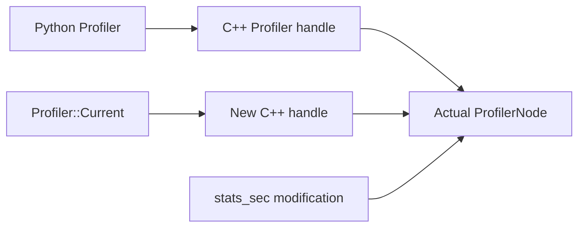

### 前言

最近在分析TVM MetaSchedule的性能，刚开始自己写了一个`Timer`去插桩测函数的时间，后来发现TVM有一个很完善的Profiler，但没有相关教程，阅读相关源码后记录一下。

### 调用方法

metaSchedule调优的模板(包括TensorIR, RelaxIR)，可参考[metaschedule template](https://github.com/ConvolutedDog/tvm-tuning-templates)

```python
with ms.Profiler() as profiler:
    database = ms.tune_tir(
        mod=MyModuleMatmul,
        target=target,
        # max times to run the candidate programs in device(e.g. GPU)
        max_trials_global=8,
        num_trials_per_iter=8,
        work_dir=work_dir,
    )

print(profiler.table())
```

> 会拿到tuning过程中SendToBuilder, UpdateCostModel等各阶段的耗时

### 实现原理

#### python C++互调

python端`with ms.Profiler as profiler`实例化一个`Profiler python`对象, `__init__`方法调用C++后端实例化一个`Profiler C++`对象。python端的profiler与C++端的profiler相互绑定，`python profiler`中存有`C++ profiler`的`chandle`



### 基于RAII实现的Timer

C++后端：`Profiler`通过构造时开始计时，析构时停止计时，并记录性能数据，从而实现了一个自动的Timer。

`Python`前端：`profiler`进入`with`作用域时，自动执行`__enter__`方法，调用C++后端注册的名为`ProfilerEnterWithScope`的函数。

`__enter__`: 

```python
    def __enter__(self) -> "Profiler":
        """Entering the scope of the context manager"""
        _ffi_api.ProfilerEnterWithScope(self)  # type: ignore # pylint: disable=no-member
        return self
```

`ProfilerEnterWithScope`

```C++
std::vector<Profiler>* ThreadLocalProfilers() {
  static thread_local std::vector<Profiler> profilers;
  return &profilers;
}

void Profiler::EnterWithScope() {
  ThreadLocalProfilers()->push_back(*this);
  (*this)->total_timer = ProfilerTimedScope("Total");
}
```

`EnterWithScope`将当前对象`profiler`加入到静态变量`profilers` 中。

### Example work through

以下面代码(省去了功能代码)为例：

```cpp
std::vector<Schedule> EvolutionarySearchNode::State::PickBestFromDatabase(int num) {
  auto _ = Profiler::TimedScope("EvoSearch/PickBestFromDatabase");
  /// A lot of work to pick best from database....
  /// ...
}
```

这段代码能够测出该函数的调用耗时：

`Profiler::TimedScope("EvoSearch/PickBestFromDatabase")`实例化了一个名为``EvoSearch/PickBestFromDatabase `的`ScopedTimer`对象。`class ScopedTimer`定义如下，`deferred_`函数在析构时(离开PickBestFromDatabase作用域时) 被调用，用于结束计时，并将数据写入profiler中。 

```cpp
class ScopedTimer {
 public:
  ~ScopedTimer() {
    if (deferred_ != nullptr) {
      deferred_();
    }
  }
 private:
  friend class Profiler;
  explicit ScopedTimer(runtime::TypedPackedFunc<void()> deferred) : deferred_(deferred) {}
  runtime::TypedPackedFunc<void()> deferred_;
};
```

每一个`ScopedTimer`对象都有一个统一`deferred_`函数：

```cpp
PackedFunc ProfilerTimedScope(String name) {
  if (Optional<Profiler> opt_profiler = Profiler::Current()) {
    return TypedPackedFunc<void()>([profiler = opt_profiler.value(),                  //
                                    tik = std::chrono::high_resolution_clock::now(),  // record the starting time
                                    name = std::move(name)]() {
      // record the ending time when deconstructed
        auto tok = std::chrono::high_resolution_clock::now();
      double duration =
          std::chrono::duration_cast<std::chrono::nanoseconds>(tok - tik).count() / 1e9;
      profiler->stats_sec[name] += duration;
    });
  }
  return nullptr;
}
```

程序开始的时间在匿名函数的捕获列表中，以默认值的方式被记录下来(非常妙)。即`ScopedTimer`对象构造时，尽管`deferred_`函数未执行，但其捕获列表中的`tik`被初始化为当前时刻(即PickBestFromDatabase函数开始执行的时刻)。

当要离开作用域时，`deferred_`被调用，将`duration`记录在`profiler`中。

### ❓疑问

以上逻辑容易懂，但是有个地方我想了很久才想明白：

`ScopedTimer`对象构造给`deferred_`赋值时，通过`Profiler::Current`得到的`profile`对象是`ThreadLocalProfiler`中`profilers.back()`的硬拷贝，为什么`profiler->stats_sec[name] += duration;`修改的却是最初C++端的profiler(或者说第一个profiler，python端调用C++实例化的第一个profiler)。

如下：

```cpp
Optional<Profiler> Profiler::Current() {
  std::vector<Profiler>* profilers = ThreadLocalProfilers();
  if (profilers->empty()) {
    return NullOpt;
  } else {
      // 将profilers最后一个元素硬拷贝后，返回
    return profilers->back();
  }
}
// .... 
PackedFunc ProfilerTimedScope(String name) {
    // opt_profiler是profilers.back()的硬拷贝
  if (Optional<Profiler> opt_profiler = Profiler::Current()) {
    return TypedPackedFunc<void()>([profiler = opt_profiler.value(),//hard copy                  //
                                    tik = std::chrono::high_resolution_clock::now(),  // record the starting time
                                    name = std::move(name)]() {
      // record the ending time when deconstructed
        auto tok = std::chrono::high_resolution_clock::now();
      double duration =
          std::chrono::duration_cast<std::chrono::nanoseconds>(tok - tik).count() / 1e9;
        // 这个profiler经过多次hard copy而来, 已不是进入作用域时push back到
        // std::vector<Profiler> profilers中的那个profiler了
      profiler->stats_sec[name] += duration;
    });
  }
  return nullptr;
}
```

`Profiler`是一个引用计数的指针(runtime::ObjectRef), 指向一个`ProfilerNode`, 数据存在`ProfilerNode.stats_sec`中。假设`Profiler p1`指向`ProfilerNode n1`，那么对`p1`的硬拷贝`p2`指向的仍然是`n1`，即`p1->stats_sec = p2->stats_sec = n1.stats_sec`。一句话总结就是，硬拷贝的是指针，而不是指针指向的数据！

### 一个精简的`Profiler`实现

https://gist.github.com/BenkangPeng/c3a5b1bcf9ff122a5f3c9f11223067cc

